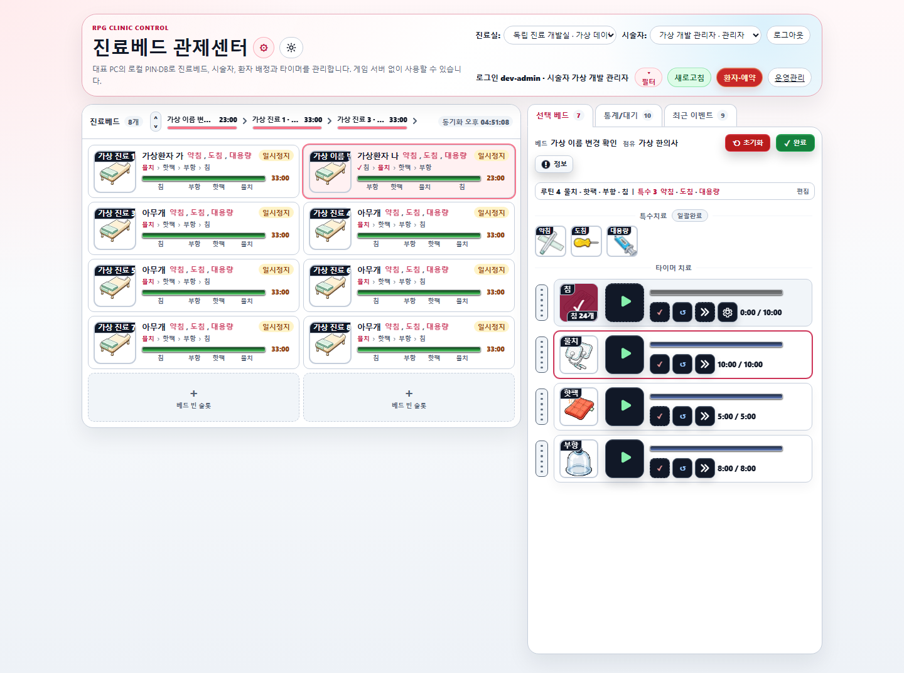

# 의맥전기 진료실 타이머 · Windows 시험판

진료실의 베드별 치료 순서와 남은 시간을 한눈에 확인하는 **Windows 진료 타이머**입니다. 기본 8개 베드는 게임 실행이나 게임 계정 없이 사용할 수 있습니다.

## 먼저 시작하기

| 필요한 것 | 바로가기 |
| --- | --- |
| 설치부터 사용·백업·문제 해결까지 | [다운로드와 사용서 열기](https://is2js.github.io/uimaek-clinic-trial/) |
| Windows x64 시험판 설치 파일 | [0.1.3 설치 파일 받기](https://is2js.github.io/uimaek-clinic-trial/downloads/PvpLocalClinicTrialSetup-0.1.3.exe) |
| 설치 파일의 확인용 해시 | [SHA-256 목록 보기](https://is2js.github.io/uimaek-clinic-trial/downloads/SHA256SUMS.txt) |

설치본을 사용하는 데 Python이나 개발 도구는 필요하지 않습니다. 처음 사용하는 분은 다운로드 전에 **[설치와 첫 설정 안내](https://is2js.github.io/uimaek-clinic-trial/#start)**를 함께 읽어 주세요.

## 화면 미리보기



> 가상 데이터로 만든 화면 예시입니다. 설치 버전과 저장된 설정에 따라 실제 화면은 다를 수 있습니다. [원본 이미지 크게 보기](assets/rpg/local-clinic/trial-site/timer-preview.png)

## 무엇을 할 수 있나요?

- **베드별 치료 타이머:** 기본 8개 베드에서 물치·핫팩·부항·침 등 치료의 시간과 진행 상태를 확인합니다.
- **진행 상태 확인:** 선택한 베드의 치료를 시작하고, 필요할 때 일시정지·재개·완료할 수 있습니다.
- **내 PC에 저장:** 기본 진료는 대표 Windows PC에서 실행되며 게임 연결이 필요하지 않습니다. 9개 이상 베드 확장은 별도 온라인 승인 절차가 필요합니다.
- **백업과 CSV:** 서버 앱에서 백업 상태를 확인하고, 관리자 인증 후 치료 기록을 CSV로 내보낼 수 있습니다. 자세한 조건은 [데이터와 백업 안내](https://is2js.github.io/uimaek-clinic-trial/#data)를 확인하세요.

## 설치하고 사용하기

1. **[다운로드·사용서](https://is2js.github.io/uimaek-clinic-trial/)**에서 시험판의 파일 정보와 안내를 확인하고 Windows x64 설치 파일을 받은 뒤 실행합니다.
2. 앱의 안내에 따라 진료실 이름, 관리자 ID와 PIN을 설정하고 **백업 복구 암호를 별도로 보관**합니다.
3. 서버 준비 상태를 확인하고 **진료 화면 열기**를 누릅니다. 처음에는 진료실 인증서 등록 안내를 읽고 직접 동의합니다.
4. 설정한 관리자 ID와 PIN으로 로그인한 뒤 베드와 치료 항목을 확인합니다.

단계별 화면과 도움이 필요할 때의 설명은 [사용서](https://is2js.github.io/uimaek-clinic-trial/#start)를 기준으로 확인하세요.

> **시험판 안내:** 현재 설치 파일은 코드 서명이 없습니다. PC나 기관의 보안 정책에 따라 설치가 제한될 수 있습니다. 설치 파일의 출처·버전·SHA-256을 확인하되, **해시는 코드 서명을 대신하지 않습니다.** 인증서 등록에 동의하면 현재 Windows 사용자가 로컬 진료실 CA를 신뢰하게 됩니다. 안내를 읽고 사용자가 직접 동의하세요.

시험판의 데이터·PIN·백업은 일반 앱 개발 채널과 별도이며 자동으로 공유되거나 이전되지 않습니다. 백업은 다른 안전한 저장소에도 보관하고, 복구 암호는 백업과 따로 보관하세요. CSV는 암호화되지 않습니다.

## GitHub에서 저장소 살펴보기

이 저장소에는 **다운로드·사용서의 정적 사이트와 시험판 설치 파일**이 들어 있습니다. 앱 전체 원본 소스 저장소가 아닙니다. 저장소를 clone하면 파일을 살펴볼 수 있지만, 앱이 자동으로 설치되거나 실행되지는 않습니다. 설치 EXE만 약 **52.3 MiB**이므로 복제할 때 디스크 공간과 다운로드 시간을 확인하세요.

Git을 설치한 뒤, 연습할 위치에서 아래 명령을 사용할 수 있습니다.

```powershell
git clone https://github.com/is2js/uimaek-clinic-trial.git
cd uimaek-clinic-trial
ls
```

Windows PowerShell에서 `ls`는 `Get-ChildItem`의 기본 별칭입니다. Windows 명령 프롬프트에서는 `dir`을 사용할 수 있습니다. `README.md`는 이 안내 문서, `index.html`은 다운로드·사용서 페이지, `assets/`는 이미지와 스타일, `downloads/`는 설치 파일과 해시 목록입니다. `release.json`에는 버전과 설치 파일 정보가 들어 있습니다.

## 개발자: 사이트 미리보기와 갱신

이 저장소는 GitHub Pages용 정적 결과와 검증된 시험판 설치본을 담습니다. Pages는 `main`의 루트를 배포 소스로 사용하며 `.nojekyll`로 정적 파일을 제공합니다. 페이지는 `release.json`의 버전·용량·해시를 표시하고 설치 파일과 해시 목록을 같은 사이트에서 제공합니다. 이 정적 사이트 자체에는 서버 API·로그인·진료 DB가 없으며 외부 설치본을 자동 실행하지 않습니다.

<details>
<summary>로컬 미리보기와 원본 프로젝트에서 갱신하는 방법</summary>

이 저장소의 페이지를 로컬에서 확인하려면 저장소 루트에서 아래 명령을 실행하고 [http://127.0.0.1:5186/](http://127.0.0.1:5186/)을 엽니다. Python은 이 미리보기를 실행하는 사람에게만 필요합니다. 종료하려면 터미널에서 `Ctrl+C`를 누릅니다.

```powershell
python -m http.server 5186 --bind 127.0.0.1
```

HTML 파일을 직접 열면 ES module과 다운로드 조회가 제한될 수 있으므로 HTTP(S)로 제공하세요.

사이트를 갱신할 때는 **별도 원본 PVP 프로젝트**의 `templates/rpg-local-clinic-download.html`, `assets/rpg/local-clinic/trial-site.css`와 가이드를 수정합니다. 아래 명령은 이 저장소의 clone에서 바로 실행하는 명령이 아니라 원본 PVP 프로젝트의 개발자용 명령입니다. 시험판 EXE가 바뀌면 버전을 올리고 클린 빌더의 자체 검사·manifest·해시 확인을 완료한 뒤 내보냅니다.

```powershell
.venv/Scripts/python.exe -X utf8 tools/build_local_clinic_desktop.py --channel trial --version 0.1.3
.venv/Scripts/python.exe -X utf8 tools/export_local_clinic_trial_site.py --output ../uimaek-clinic-trial --base-path ./
```

내보내기는 관리 표식과 파일 해시를 확인해 변경된 출력이나 무관한 디렉터리를 덮어쓰지 않습니다. 이 저장소의 관리 표식을 유지하고 관리 대상 결과를 수동 편집하지 않습니다. 별도 작업 복사본에서 재생성할 때도 HTML·자산·`release.json`·해시·설치본을 함께 검토합니다.

이 저장소에서 변경 목록과 다운로드 동작을 확인한 뒤 관련 경로만 스테이징하고 커밋해 `main`에 push합니다. 실제 Pages 배포 성공과 인증 없는 HTTPS, 브라우저 다운로드 및 설치본 SHA-256을 확인합니다. PVP 원본 저장소나 인트로 저장소를 이 작업으로 push하지 않습니다. `.env`, DB, 키, 로그나 실제 계정·진료 자료는 이 저장소에 추가하지 않습니다.

</details>

RPG 인트로의 한의원 풍경과 종이색·짙은 녹색·금색을 참고했습니다. favicon은 PVP RPG의 `medical-needle-r1` 원본이며 같은 원본 ICO가 앱과 설치 EXE에도 포함됩니다. 이미지의 출처는 [브랜딩 정보](assets/rpg/local-clinic/trial-site/branding-source.json)와 [화면 예시 정보](assets/rpg/local-clinic/trial-site/preview-source.json)에 기록되어 있습니다.
